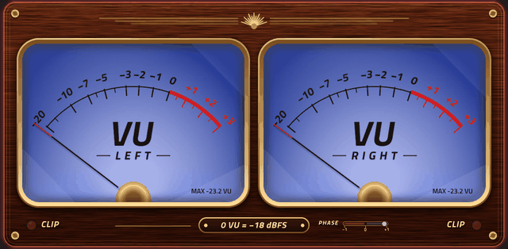
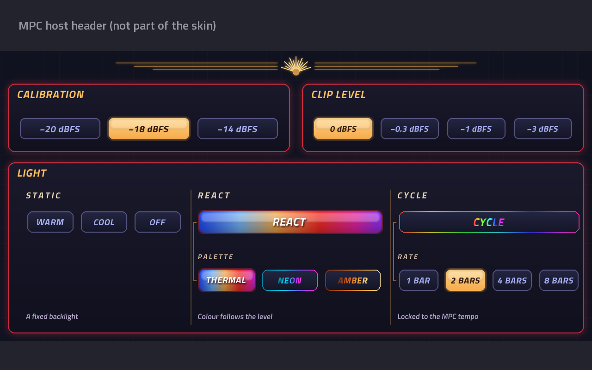

# Slow Ops VU Meter (MPC)

An analog-style VU meter insert effect for Akai MPC standalone (MPC OS 3.10.1+).

- **Stereo VU meter**: two independent L/R needles. It only measures; the audio passes through untouched.
- **Ballistics**: full-wave average-responding with second-order needle dynamics aimed at IEC 60268-17. The design target is 99 % in 300 ms with 1.3 % overshoot, verified in `core_tests`.
- **Calibration**: 0 VU = −20 / −18 / −14 dBFS. The reference is a 1 kHz sine whose *peak* is at that level.
- **CLIP lamps**: sample-peak at a selectable CLIP LEVEL, with an optional 2 s hold. Tap a lamp to reset it. This is not true-peak detection.
- **LIGHT**: Warm, Cool, Off, **React** or **Cycle**.
  - **React** makes the dials and cabinet glow blue → red → purple as the program heats up, with filament-like warm-up and cool-down. 
  - **Cycle** sweeps round the hue wheel once every two bars, locked to the MPC's tempo and song position. 
- **AUTO trim**: one tap, 3 s of listening, and TRIM is set so the music averages 0 VU.
- **PHASE** correlation meter, **MAX** VU readouts, and a selectable **CLIP LEVEL** (0 / −0.3 / −1 / −3 dBFS).
- **Two tabs.** METER has the dials, PHASE, MAX, CLIP lamps, PEAK, BYPASS and OUTPUT (TRIM + AUTO). SETUP has CALIBRATION, CLIP LEVEL and a LIGHT box grouped as STATIC (warm/cool/off), REACT with its palette, and CYCLE with its rate.
- **Output TRIM** (±12 dB, smoothed) and **BYPASS**. At 0.0 dB, or with Bypass on, the output is a **bit-exact** copy of the input. The meters read the output signal.

| METER | SETUP |
|---|---|
|  |  |

*Previews are rendered on the desktop from the real skin assets. Hardware captures go in `docs/HARDWARE_RESULTS.md`.*

## Status

| | |
|---|---|
| Core engine (ballistics, calibration, clip, trim, React heat, Cycle hue, auto trim, correlation) | Tested on desktop (`core_tests`, 77 checks) |
| Real plugin binary through the VST2 ABI | Tested on desktop (`host_sim` 20 and `scenario_host` 76 checks) |
| Skin JSON / assets consistency | Tested on desktop (`check_skins.py`) |
| **Needle animation, view switching and memory on an MPC** | **Not yet tested.** See `docs/SPIKE.md` |

## Build and test

```sh
git submodule update --init           # SDK pinned at febd2ca
./scripts/test.sh                     # native + arm32 + arm64, validation, all tests
./scripts/package.sh                  # dist/vu-meter-0.1.0-mpc.zip
MPC_ADDRESS=<ip> ./scripts/deploy.sh  # install over the network (developer mode) and restart
./scripts/make_art.sh                 # redraw skin PNGs + previews (creates build/venv with Pillow)
```

The output folder is `plugin/build/Slow Ops - VST - VU Meter/`.

## Install on the MPC

1. Copy `Slow Ops - VST - VU Meter` into a `VST2 Plugins` folder at the top level of a drive.
2. On MPC OS 3.10.1 or later, go to **Preferences → Enhancements (Beta)** and turn on **Enable Enhancements** and **External Plugin Support**. Restart.
3. Add **Slow Ops › VU Meter** as an insert effect. The MPC only rereads skins on restart.

## Layout

```
core/include/slowops/vumeter/   NeedleDynamics, VuEngine, PeakDetector, Trim (standard library only)
plugin/src/SlowOpsVUMeter.cpp   thin mpc::Plugin adapter (parameters, display publishing)
plugin/skins/                   generated and committed: TUI.json, Q-Links.json, PNGs
scripts/skin_layout.py          shared geometry: dials, tick formula, needle sectors, widget rects
scripts/make_skin_art.py        Pillow artwork (original, generated from code)
scripts/gen_skins.py            TUI.json / Q-Links.json from plugin/build/params.json
scripts/check_skins.py          skin ↔ parameter validation
tests/core_tests.cpp            engine tests (spec section 8.1)
tests/scenario_host.cpp         real-binary integration tests (spec section 8.2)
```

**Needle rendering.** Each needle is split into 4 angular *sector* filmstrips. Each sector is a small transparent sprite, and frame 0 is blank. The plugin shows exactly one sector per needle. This keeps all needle art at about 22 MiB decoded, and about 71 MiB for all images. Faces are swapped by a plugin-computed `View` parameter (the Light setting). The v0.1 MONO view was retired in v0.2; its parameter slots remain so indices stay stable, but they are unused.

Font: Titillium Web (SIL OFL 1.1, `assets/fonts/OFL.txt`). Licence: MIT.
