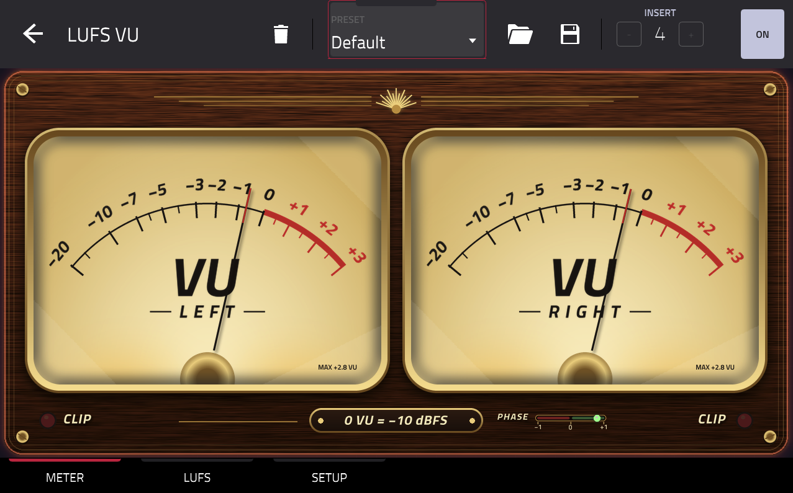
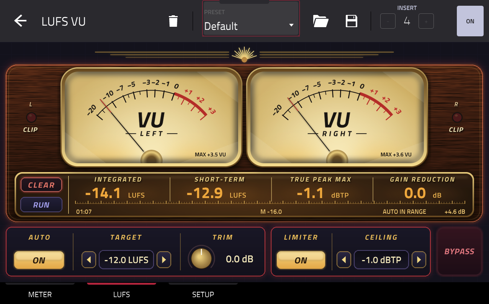
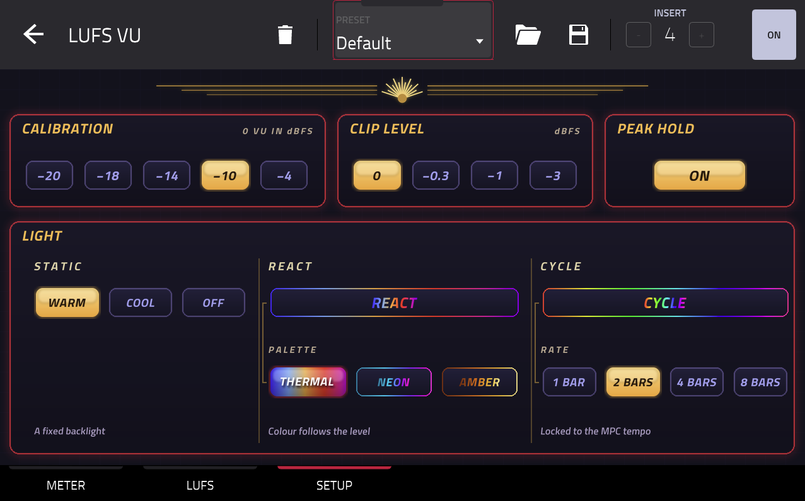

# Slow Ops LUFS VU (MPC)

Analog VU meters, EBU R 128 loudness and a true-peak limiter: an insert effect for Akai MPC standalone (MPC OS 3.10.1+). Version **1.0.0**. Called "VU Meter" before 1.0.

| METER | LUFS | SETUP |
|---|---|---|
|  |  |  |

*Screenshots from an MPC Live III.*

## Install

1. Download `lufs-vu-1.0.0-mpc.zip` from the release and unzip it.
2. Copy the `Slow Ops - VST - LUFS VU` folder into a folder named `VST2 Plugins` at the top level of a USB drive, SD card or the MPC's internal drive.
3. On the MPC: **Preferences → Enhancements (Beta)**, then turn on **Enable Enhancements** and **External Plugin Support**. Restart the MPC.
4. Add **Slow Ops › LUFS VU** as an insert effect (plugin browser → External Plugins).

Updating from "VU Meter": delete the old `Slow Ops - VST - VU Meter` folder, then add LUFS VU again on any track that used it.

The zip also contains **LUFS VU User Guide.html**, a one-page manual with every control (source: [docs/user-guide.html](docs/user-guide.html); full reference: [docs/CONTROLS.md](docs/CONTROLS.md)).

## Features

- **Stereo VU meter**: two independent L/R needles. With AUTO off, TRIM at 0.0 dB and LIMITER off it only measures, and the audio passes through bit-exact with zero latency.
- **LUFS tab** (ITU-R BS.1770 / EBU R 128): INTEGRATED (gated), SHORT-TERM, MOMENTARY, TRUE PEAK MAX (4× oversampled, post-processing) and limiter GAIN REDUCTION, on a smoked-glass "radio dial" strip under the same VU meters. CLEAR and RUN/HOLD control the measurement.
- **AUTO loudness** (off by default): gently steers the programme's integrated loudness towards a TARGET (−23 … −9 LUFS, default −14). It moves at most 0.5 dB/s, holds during silence and is limited to ±12 dB. It is a best-effort live estimate, not a guarantee.
- **True-peak LIMITER** (off by default) with a CEILING of −6.0 … −0.1 dBTP (default −1.0). It is stereo-linked with a 3 ms look-ahead, which adds about 3.2 ms of latency **only while it is on**; the latency is reported to the MPC.
- **Ballistics**: full-wave average-responding with second-order needle dynamics aimed at IEC 60268-17. The design target is 99 % in 300 ms with 1.3 % overshoot, verified in `core_tests`.
- **Calibration**: 0 VU = −20 / −18 / −14 / −10 / −4 dBFS (−10 and −4 for loud, dense masters). The reference is a 1 kHz sine whose *peak* is at that level.
- **CLIP lamps**: sample-peak at a selectable CLIP LEVEL, with an optional 2 s hold. Tap a lamp to reset it. This is not true-peak detection.
- **LIGHT**: Warm, Cool, Off, **React** or **Cycle**.
  - **React** makes the dials glow blue → red → purple as the program heats up, with filament-like warm-up and cool-down.
  
  - **Cycle** sweeps round the hue wheel once every two bars, locked to the MPC's tempo and song position. 
  
- **PHASE** correlation meter, **MAX** VU readouts, and a selectable **CLIP LEVEL** (0 / −0.3 / −1 / −3 dBFS).
- **Three tabs.** METER has only the meters: the dials, PHASE, MAX and CLIP lamps. LUFS has the loudness readouts and the AUTO, TARGET, TRIM, LIMITER, CEILING, CLEAR, RUN/HOLD and BYPASS controls. SETUP has CALIBRATION, CLIP LEVEL, PEAK HOLD and a LIGHT box grouped as STATIC (warm/cool/off), REACT with its palette, and CYCLE with its rate.
- **Data wheel**: touch any control and turn the MPC's main data wheel to change it (an amber ring shows the focus); press it for the large editor. TRIM is also on Q-Link 15 on both the METER and LUFS tabs.
- **Output TRIM** (±12 dB, smoothed; on the LUFS tab) and **BYPASS** (on the LUFS tab). With TRIM at 0.0 dB (and AUTO off), or with Bypass on, the output is a **bit-exact** copy of the input. Every meter reads the output signal.

Desktop previews rendered from the skin assets (all lights and palettes) are in [docs/images](docs/images).

## Status

| | |
|---|---|
| Core engine (ballistics, calibration, clip, trim, React heat, Cycle hue, correlation, loudness, true peak, limiter, AUTO) | Tested on desktop (`core_tests`, 126 checks, including EBU Tech 3341 cases 1–5 and 9) |
| Loudness and true peak against an independent meter | `lufs_crosscheck` vs FFmpeg `ebur128`: I within 0.1 LU, TP within 0.3 dB |
| Real plugin binary through the VST2 ABI | Tested on desktop (`host_sim` 20 and `scenario_host` 105 checks) |
| Skin JSON / assets consistency | Tested on desktop (`check_skins.py`) |
| On an MPC Live III | All three tabs, needles, lights, data-wheel focus and LUFS readouts working (screenshots above). Remaining checklist items: `docs/SPIKE.md` |

## Build and test (developers)

```sh
git submodule update --init           # SDK pinned at febd2ca
./scripts/test.sh                     # native + arm32 + arm64, validation, all tests (+ FFmpeg cross-check if installed)
./scripts/release.sh                  # tests, then dist/lufs-vu-<version>-mpc.zip (+ INSTALL.txt, user guide)
MPC_ADDRESS=<ip> ./scripts/deploy.sh  # install over the network (developer mode) and restart
./scripts/make_art.sh                 # redraw skin PNGs + previews (creates build/venv with Pillow)
```

The output folder is `plugin/build/Slow Ops - VST - LUFS VU/`.

## Layout

```
core/include/slowops/vumeter/   NeedleDynamics, VuEngine, PeakDetector, Trim, KWeighting, LoudnessMeter,
                                TruePeak, TruePeakLimiter, AutoLoudness (standard library only)
plugin/src/SlowOpsVUMeter.cpp   thin mpc::Plugin adapter (parameters, display publishing)
plugin/skins/                   generated and committed: TUI.json, Q-Links.json, PNGs
scripts/skin_layout.py          shared geometry: dials, tick formula, needle sectors, widget rects
scripts/make_skin_art.py        Pillow artwork (original, generated from code)
scripts/gen_skins.py            TUI.json / Q-Links.json from plugin/build/params.json
scripts/check_skins.py          skin ↔ parameter validation
tests/core_tests.cpp            engine tests (spec section 8.1)
tests/scenario_host.cpp         real-binary integration tests (spec section 8.2, LUFS scenarios)
tests/lufs_crosscheck.cpp       renders programmes for scripts/lufs_crosscheck.py (FFmpeg comparison)
```

**Needle rendering.** Each needle is split into 4 angular *sector* filmstrips. Each sector is a small transparent sprite, and frame 0 is blank. The plugin shows exactly one sector per needle. This keeps the METER needle art at about 30 MiB decoded. METER's walnut cabinet fills the page with 560 × 400 faces. The LUFS tab keeps the smaller v0.2 dial geometry, with its own 0.8-size faces and needle strips (the MPC never shrinks an image) and a 1/8-size glow strip. All images together decode to at most about 131 MiB (counted per widget, so an upper bound). Faces are swapped by a plugin-computed `View` parameter (the Light setting). The v0.1 MONO view was retired in v0.2; its parameter slots remain so indices stay stable, but they are unused.

Font: Titillium Web (SIL OFL 1.1, `assets/fonts/OFL.txt`). Licence: MIT.
